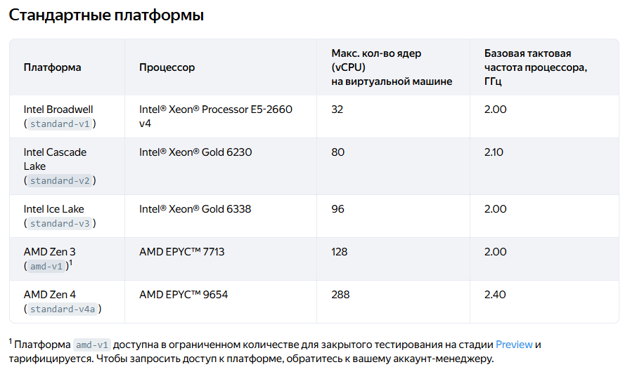
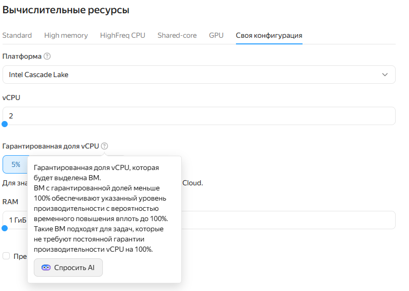
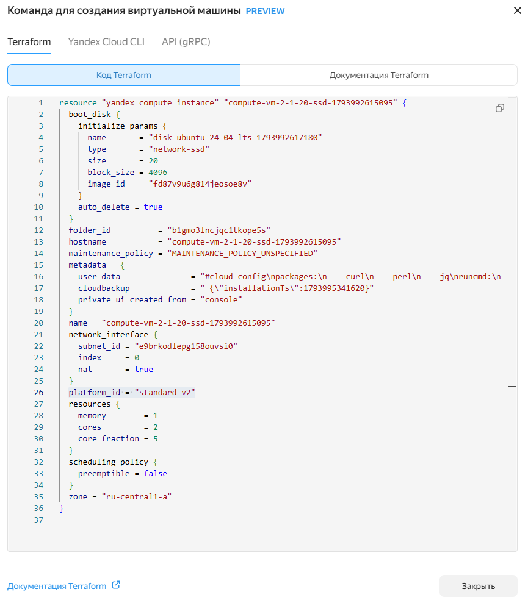
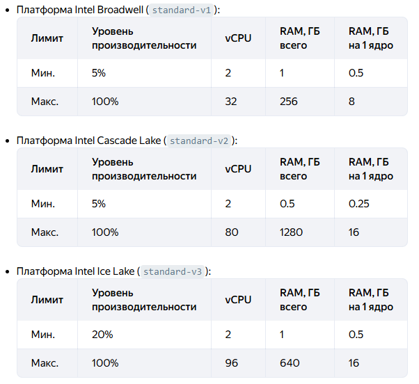
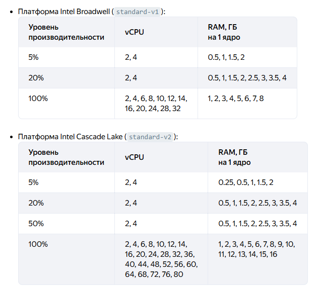
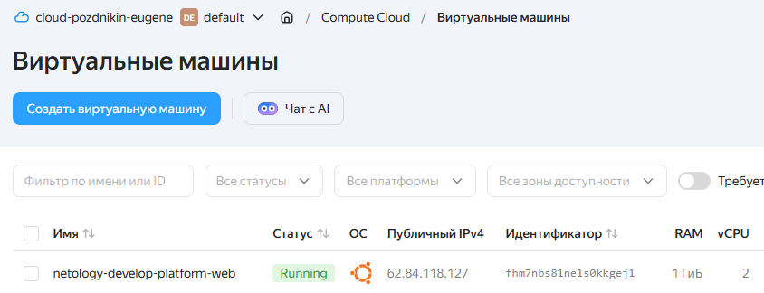
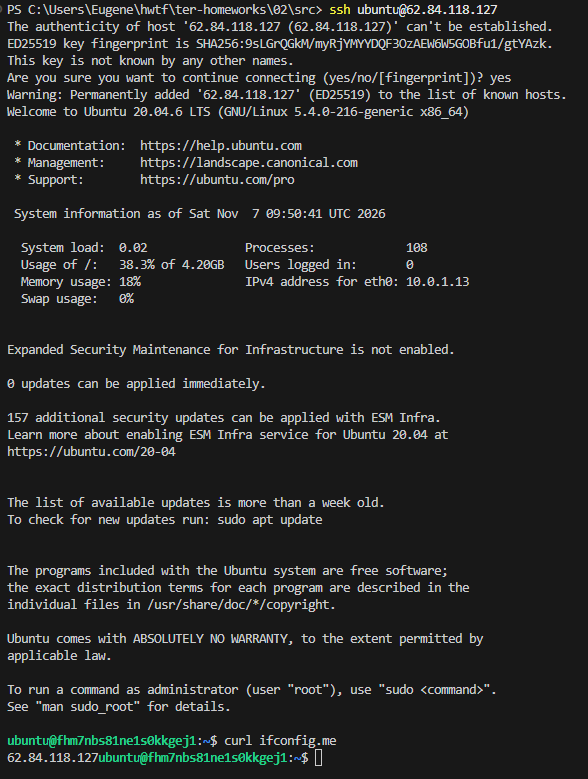
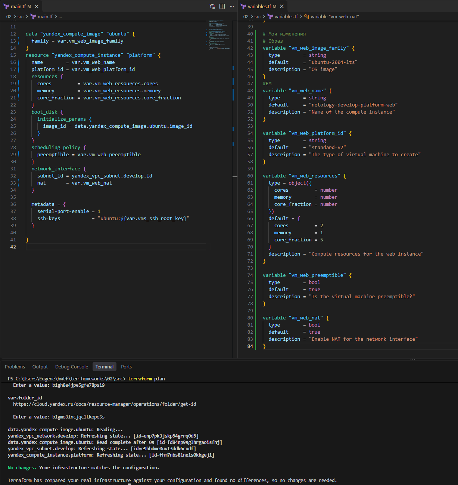
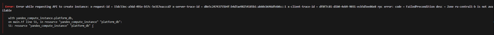

# Домашнее задание к занятию "`Название занятия`" - `Фамилия и имя студента`


### Инструкция по выполнению домашнего задания

   1. Сделайте `fork` данного репозитория к себе в Github и переименуйте его по названию или номеру занятия, например, https://github.com/имя-вашего-репозитория/git-hw или  https://github.com/имя-вашего-репозитория/7-1-ansible-hw).
   2. Выполните клонирование данного репозитория к себе на ПК с помощью команды `git clone`.
   3. Выполните домашнее задание и заполните у себя локально этот файл README.md:
      - впишите вверху название занятия и вашу фамилию и имя
      - в каждом задании добавьте решение в требуемом виде (текст/код/скриншоты/ссылка)
      - для корректного добавления скриншотов воспользуйтесь [инструкцией "Как вставить скриншот в шаблон с решением](https://github.com/netology-code/sys-pattern-homework/blob/main/screen-instruction.md)
      - при оформлении используйте возможности языка разметки md (коротко об этом можно посмотреть в [инструкции  по MarkDown](https://github.com/netology-code/sys-pattern-homework/blob/main/md-instruction.md))
   4. После завершения работы над домашним заданием сделайте коммит (`git commit -m "comment"`) и отправьте его на Github (`git push origin`);
   5. В личном кабинете прикрепите и отправьте ссылку на решение в виде md-файла в вашем Github.
   6. Любые вопросы по выполнению заданий спрашивайте в разделе “Вопросы по заданию” в личном кабинете.
   
Желаем успехов в выполнении домашнего задания!
   
### Дополнительные материалы, которые могут быть полезны для выполнения задания

1. [Руководство по оформлению Markdown файлов](https://gist.github.com/Jekins/2bf2d0638163f1294637#Code)

---

### Задание 1


#### Проблема при инициализации 

```HCL
PS C:\Users\Eugene\hwtf\ter-homeworks\02\src> terraform init
Initializing the backend...
Initializing provider plugins...
- Finding latest version of yandex-cloud/yandex...
╷
│ Error: Failed to query available provider packages
│ 
│ Could not retrieve the list of available versions for provider yandex-cloud/yandex: failed to query provider mirror https://terraform-registry-mirror.ru/ for registry.terraform.io/yandex-cloud/yandex: the request failed after 2
│ attempts, please try again later: Get "https://terraform-registry-mirror.ru/registry.terraform.io/yandex-cloud/yandex/index.json": context deadline exceeded (Client.Timeout exceeded while awaiting headers)
│ 
│ To see which modules are currently depending on yandex-cloud/yandex and what versions are specified, run the following command:
│     terraform providers
```

Создайте файл конфигурации. В Windows этот файл должен называться terraform.rc и находиться в папке %APPDATA%. Вы можете открыть её, выполнив в PowerShell команду $env:APPDATA, или создать файл вручную по этому пути.

```
provider_installation {
  network_mirror {
    url     = "https://terraform-mirror.yandexcloud.net/"
    include = ["registry.terraform.io/*/*"]
  }
  direct {
    exclude = ["registry.terraform.io/*/*"]
  }
}

```
<details>
  <summary> Решено </summary>

```PowerShell
PS C:\Users\Eugene\hwtf\ter-homeworks\02\src> terraform init                                                                                                      
Initializing the backend...
Initializing provider plugins...
- Finding latest version of yandex-cloud/yandex...
- Installing yandex-cloud/yandex v0.244.0...
- Installed yandex-cloud/yandex v0.244.0 (unauthenticated)
Terraform has created a lock file .terraform.lock.hcl to record the provider
selections it made above. Include this file in your version control repository
so that Terraform can guarantee to make the same selections by default when
you run "terraform init" in the future.

╷
│ Warning: Incomplete lock file information for providers
│ 
│ Due to your customized provider installation methods, Terraform was forced to calculate lock file checksums locally for the following providers:
│   - yandex-cloud/yandex
│ 
│ The current .terraform.lock.hcl file only includes checksums for windows_amd64, so Terraform running on another platform will fail to install these providers.
│ 
│ To calculate additional checksums for another platform, run:
│   terraform providers lock -platform=linux_amd64
│ (where linux_amd64 is the platform to generate)
╵
Terraform has been successfully initialized!

You may now begin working with Terraform. Try running "terraform plan" to see
any changes that are required for your infrastructure. All Terraform commands
should now work.

If you ever set or change modules or backend configuration for Terraform,
rerun this command to reinitialize your working directory. If you forget, other
commands will detect it and remind you to do so if necessary.
```
</details>
---

#### Проблемы конфигурации 

Ошибка Platform "standart-v4" not found

```Sh
╷
│ Error: Error while requesting API to create instance: x-request-id = fe9c337f-f8ff-4179-b39f-9260e2472ea6 x-server-trace-id = 13003841aea48022:e8da9ed5c4d0d172:455589b9ca5c0cd5:1 x-client-trace-id = 4628f949-af80-4589-bf41-23637345d24d rpc error: code = FailedPrecondition desc = Platform "standart-v4" not found
│ 
│   with yandex_compute_instance.platform,
│   on main.tf line 15, in resource "yandex_compute_instance" "platform":
│   15: resource "yandex_compute_instance" "platform" {
│ 
╵
```
Тут 2 ошибки 

Первая орфографическая (опечатка) `standart` пишется с буквой `d` на конце - правильно `standard`

Далее после этого исправления снова ошибка та же самая но суть очень другая.

```PowerShell
╷
│ Error: Error while requesting API to create instance: x-request-id = e1716a9c-8adb-4833-8027-fe8ec5b581fe x-server-trace-id = fcc37b2cfef63b9e:e9b2213b9754414c:3a8118c4b3ae71ac:1 x-client-trace-id = 7ed53451-8532-48ca-98ec-46d64d178b34 rpc error: code = FailedPrecondition desc = Platform "standard-v4" not found
│ 
│   with yandex_compute_instance.platform,
│   on main.tf line 15, in resource "yandex_compute_instance" "platform":
│   15: resource "yandex_compute_instance" "platform" {
│ 
╵
```
Вторая ошибка логическая - `standard-v4` не существует

Что вообще такое эти ваши standardы? Этот параметр отвечает за выбор мощности путем выбора процессора среди стандартных платформ (не высокроизводительных и не с ГПУ).

[Подробнее можно узнать из документации](https://yandex.cloud/ru/docs/compute/concepts/vm-platforms)

Вот краткая выдержка по standardтам



Нужно выбрать другой.

Сразу вопрос а какой? Любой? Не любой.

Кажется ближе всего standard-v4a. Я уже знаю что это не правильно, но я должен это доказать.

---
#### Ошибка 3

Ошибка говорит что в standard-v4a не позволяет использовать `core fraction` отличный от 20, 50, 100

```Sh
╷
│ Error: Error while requesting API to create instance: x-request-id = a4b1ccd1-3fa8-4fb9-98d5-8d80b24d4e9f x-server-trace-id = 548aca9cb5990792:9ace18afa781e1d2:51f44b32a49978ea:1 x-client-trace-id = 026dbb06-fc7e-48f1-a252-e6a9b8a634bc rpc error: code = InvalidArgument desc = the specified core fraction is not available on platform "standard-v4a"; allowed core fractions: 20, 50, 100
│ 
│   with yandex_compute_instance.platform,
│   on main.tf line 15, in resource "yandex_compute_instance" "platform":
│   15: resource "yandex_compute_instance" "platform" {
│ 
╵
```
Почему он так говорит? Потому что у нас указано `core_fraction = 5`

Ищем для нас подходящую платформу.

При создании ВМ в вычислительных ресурсах выбираем ту платформу где начинает отображаться Гарантированная доля vCPU (он же core_fraction) 5%

Определяем что это за платформа 

Я нашел 3 способа как это увидеть   

Первый - (назовем его современный) наводимся на вопрос возле `Гарантированная доля vCPU` жмем `Спросить AI`
<details>
  <summary> Первый </summary>



</details>

Второй - (назовем его инженерный) выбираем нужный праметр и идем вниз страницы жмем на кнопку Генерация кода  
<details>
  <summary> Второй </summary>
   

Затем в блоке Terraform находим   platform_id = "standard-v2" это нужное нам значение.


</details>

Третий (самый не очевидный) - [смотрим в документации](https://yandex.cloud/ru/docs/compute/concepts/performance-levels) 



---
#### Ошибка 4

Не правильно задано количество ядер. Платформа в моей конфигурации позволяет использовать 2 или 4 ядра. У нас ядра  `cores = 1` 
```
╷
│ Error: Error while requesting API to create instance: x-request-id = fbdf3579-30cd-4a8f-96ce-dfc52dddcfe7 x-server-trace-id = 204179c9037ee28f:0db84cc9380afbf8:4dee0064b3ac2e4b:1 x-client-trace-id = 6553776e-71cd-4f29-83cc-31cee975cefa rpc error: code = InvalidArgument desc = the specified number of cores is not available on platform "standard-v2"; allowed core number: 2, 4
│ 
│   with yandex_compute_instance.platform,
│   on main.tf line 15, in resource "yandex_compute_instance" "platform":
│   15: resource "yandex_compute_instance" "platform" {
│ 
╵
```
Решение так же [находим в документации ](https://yandex.cloud/ru/docs/compute/concepts/performance-levels) 
Доступные конфигурации



Как видно ни одна конфигурация не допускает `cores = 1`. Укажу `cores = 2`

---

#### Подключение к ВМ 

Вм создана



К подключился и выполнил `curl ifconfig.me`



#### Ответы на вопросы 
Как в процессе обучения могут пригодиться параметры `preemptible = true` и `core_fraction=5` в параметрах ВМ.

Что значат эти параметры?

`preemptible = true` -  ВМ, которая работает не более 24 часов и может быть остановлена Compute Cloud в любой момент. После остановки ВМ не удаляется, все ее данные сохраняются. Чтобы продолжить работу, запустите ВМ повторно. Предоставляется с большой скидкой.   
ВМ, которая работает не более 24 часов и может быть остановлена Compute Cloud в любой момент. После остановки ВМ не удаляется, все ее данные сохраняются. Чтобы продолжить работу, запустите ВМ повторно. Предоставляется с большой скидкой.

`core_fraction=5` - Это процент вычислительного времени физического ядра, который гарантируется виртуальной машине. vCPU делит физическое ядро с другими ВМ. Производительность ниже, но и стоимость заметно меньше. Такие ВМ подходят для задач с непостоянной нагрузкой: тесты, разработка, некритичные сервисы.Это минимальная гарантированная доля — самая дешёвая конфигурация.

Отсюда следует что эти параметры помогут нам сохранить наши денежные средства. `preemptible = true` - остановит нашу ВМ, что защитит нас от того если мы вдруг сам забыли это сделать. А `core_fraction=5` даст возможность потестировать работу в облаке не платив за лишние ресурсы процессора. 


### Задание 2



---

### Задание 3



```
# yandex_compute_instance.platform_db will be created
  + resource "yandex_compute_instance" "platform_db" {
      + created_at                = (known after apply)
      + folder_id                 = (known after apply)
      + fqdn                      = (known after apply)
      + gpu_cluster_id            = (known after apply)
      + hardware_generation       = (known after apply)
      + hostname                  = (known after apply)
      + id                        = (known after apply)
      + maintenance_grace_period  = (known after apply)
      + maintenance_policy        = (known after apply)
      + metadata                  = {
          + "serial-port-enable" = "1"
          + "ssh-keys"           = (sensitive value)
        }
      + name                      = "netology-develop-platform-db"
      + network_acceleration_type = "standard"
      + platform_id               = "standard-v2"
      + reserved_instance_pool_id = (known after apply)
      + status                    = (known after apply)
      + zone                      = "ru-central1-b"

      + boot_disk {
          + auto_delete = true
          + device_name = (known after apply)
          + disk_id     = (known after apply)
          + mode        = (known after apply)

          + initialize_params {
              + block_size  = (known after apply)
              + description = (known after apply)
              + image_id    = "fd84np9sg3hrgaoisfnj"
              + name        = (known after apply)
              + size        = (known after apply)
              + snapshot_id = (known after apply)
              + type        = "network-hdd"
            }
        }

      + metadata_options (known after apply)

      + network_interface {
          + index          = (known after apply)
          + ip_address     = (known after apply)
          + ipv4           = true
          + ipv6           = (known after apply)
          + ipv6_address   = (known after apply)
          + mac_address    = (known after apply)
          + nat            = true
          + nat_ip_address = (known after apply)
          + nat_ip_version = (known after apply)
          + subnet_id      = "e9bhdmc0uvt3ddk6cudf"
        }

      + placement_policy (known after apply)

      + resources {
          + core_fraction = 20
          + cores         = 2
          + memory        = 2
        }

      + scheduling_policy {
          + preemptible = true
        }
    }

  # yandex_vpc_subnet.develop_d will be created
  + resource "yandex_vpc_subnet" "develop_d" {
      + created_at     = (known after apply)
      + folder_id      = (known after apply)
      + id             = (known after apply)
      + labels         = (known after apply)
      + name           = "develop"
      + network_id     = "enp7pk3jskp54grrq0d5"
      + v4_cidr_blocks = [
          + "10.0.2.0/24",
        ]
      + v6_cidr_blocks = (known after apply)
      + zone           = "ru-central1-b"
    }

Plan: 2 to add, 1 to change, 0 to destroy.
```


### Задание 4

`Приведите ответ в свободной форме........`

1. `Заполните здесь этапы выполнения, если требуется ....`
2. `Заполните здесь этапы выполнения, если требуется ....`
3. `Заполните здесь этапы выполнения, если требуется ....`
4. `Заполните здесь этапы выполнения, если требуется ....`
5. `Заполните здесь этапы выполнения, если требуется ....`
6. 

```
Поле для вставки кода...
....
....
....
....
```

`При необходимости прикрепитe сюда скриншоты
`
